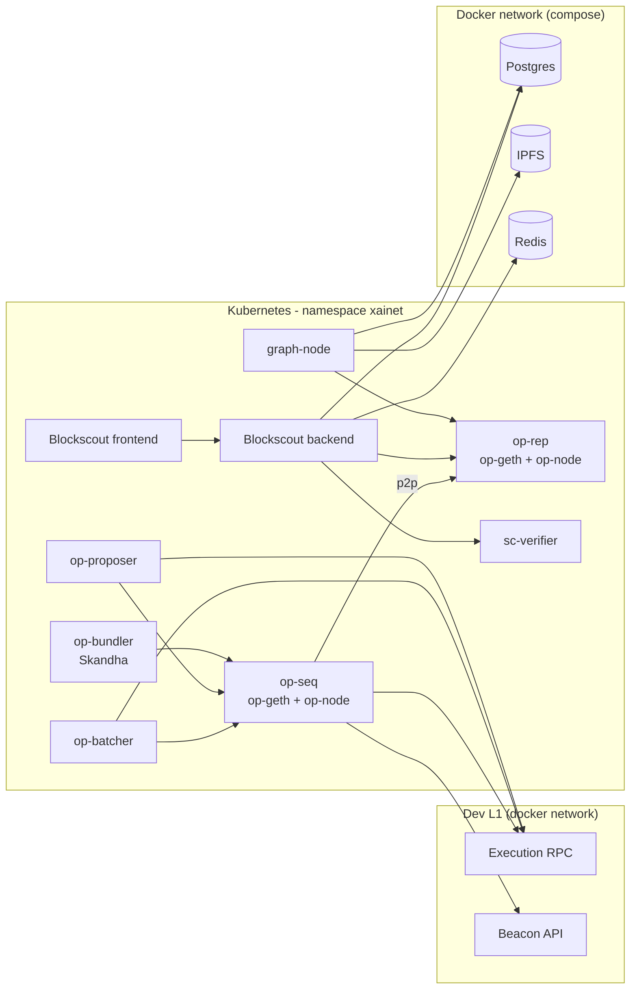

# k8s-xainet

A local OP Stack L2 devnet on Kubernetes (minikube), with block explorer, indexer and ERC-4337 bundler.

Clone it, run one command, and get a working L2 with the usual tools around it. The goal is to save you the weeks of setup work it takes to wire these pieces together.

Extracted from the development environment of [Xailour](https://xailour.net), a Community-as-a-Service platform.

> **Scope:** ephemeral local development network. It is **not** a production setup.
> The `base/` + `overlays/` layout is meant to be extended for other environments, but only `dev` is provided and tested.

<!-- TODO: add CI badge (kustomize build + kubeconform) -->

## What you get

| Component                                               | Role                                                                               | Version                                  |
|---------------------------------------------------------|------------------------------------------------------------------------------------|------------------------------------------|
| `op-seq` (op-geth + op-node)                            | Sequencer                                                                          | op-geth `v1.101702.2`, op-node `v1.19.4` |
| `op-rep` (op-geth + op-node)                            | Read replica, used by the explorer and the indexer                                 | same as above                            |
| `op-batcher`                                            | Posts L2 data to L1 (calldata by default)                                          | `v1.16.2`                                |
| `op-proposer`                                           | Posts output proposals to L1                                                       | `v1.16.3`                                |
| Blockscout (backend, frontend, smart-contract verifier) | Block explorer                                                                     | `9.0.2` / `v2.3.5` / `v1.11.0`           |
| graph-node                                              | The Graph indexer                                                                  | `v0.45.0`                                |
| Skandha                                                 | ERC-4337 bundler (standalone mode)                                                 | `v2-2.4.6`                               |
| Postgres, IPFS, Redis                                   | Dependencies of the above, run with Docker Compose                                 | see `compose/`                           |
| Deterministic deployment proxy + EntryPoint             | Deployed on your L2 with scripts, see [below](#deterministic-proxy-and-entrypoint) | see `scripts/`                           |

All image tags are pinned.

## Architecture



## Requirements

- Linux (tested). macOS and Windows: see [Platform notes](#platform-notes).
- Docker
- minikube (docker driver) and kubectl
- Node.js `[TODO: version]` for the deploy scripts
- About `[TODO: CPUs]` CPUs and `[TODO: GB]` GB of RAM free for minikube
- A dev L1 (execution RPC + beacon API) reachable from the cluster: `[TODO: how this repo starts it]`

Tested with Kubernetes `[TODO: K8S_VERSION]` and minikube `[TODO: version]`.

## Quick start

```bash
git clone https://github.com/eggnetlab/k8s-xainet.git
cd k8s-xainet
./scripts/up.sh      # [TODO: final name]
```

`up.sh` runs these steps. You can run them one by one if you prefer:

1. Create the dev Docker network and start Postgres, IPFS and Redis (`compose/`).
2. Start the dev L1. `[TODO]`
3. Start minikube (addons: ingress, ingress-dns, registry, plus metrics-server).
4. Build the `l2-conf` image and push it to the minikube registry. `l2-conf` generates the genesis, the rollup config and deploys the L1 contracts.
5. Apply `k8s/overlays/dev/setup`, run the init jobs and wait for `init-l2` to finish.
6. Apply the rest of `k8s/overlays/dev`.
7. Deploy the deterministic proxy and the EntryPoint, then update the bundler config (see below).

To remove everything, including volumes and the minikube cluster:

```bash
./scripts/down.sh    # [TODO: final name]
```

## Endpoints

| Service             | Address                                                |
|---------------------|--------------------------------------------------------|
| Explorer            | `http://explorer.xailour.xaidev`                       |
| The Graph (queries) | `http://graph.xailour.xaidev`                          |
| L2 RPC              | `[TODO: ingress host or kubectl port-forward command]` |
| Bundler             | `[TODO]` (port `14337` in the cluster)                 |

`*.xaidev` names are resolved by the minikube `ingress-dns` addon. If your host does not use it, add the hosts to `/etc/hosts` instead. `[TODO: resolver setup per OS]`

## Default network values

|                   |                                                          |
|-------------------|----------------------------------------------------------|
| L2 name           | `xainet`                                                 |
| L2 chain ID       | `19970727` `[TODO: confirm it is configurable]`          |
| L1 chain ID       | `900`                                                    |
| Currency          | ETH, 18 decimals                                         |
| Data availability | calldata (`blobs` is possible, see `batcher-config-env`) |

## Deterministic proxy and EntryPoint

The deterministic deployment proxy and the ERC-4337 EntryPoint have well-known addresses, but those addresses are only valid on known networks. On a custom chain ID the proxy transaction and the
address of everything deployed through it (the EntryPoint included) are different.

For this reason the repo does not rely on canonical addresses:

- `scripts/[TODO]` builds the proxy deployment transaction from the chain ID of your network.
- `scripts/[TODO]` deploys the EntryPoint through the proxy.
- Both scripts print the resulting addresses and write them to `[TODO: addresses.json]`.

Use these addresses in your bundler and SDK configuration. The bundler config for `dev` lives in `k8s/overlays/dev/bundler/configmap.yaml` and must contain the EntryPoint address printed by the
script. Restart the bundler after changing it.

With the same chain ID and the same bytecode, the addresses are always the same. The EntryPoint bytecode comes from `[TODO: official release + version]`. `[TODO: license note, see Licenses]`

## Repository layout

```
k8s/
  base/               # neutral manifests: no secrets, no environment values
  overlays/
    dev/              # everything specific to the local devnet (incl. init jobs)
compose/              # Postgres, IPFS, Redis (Docker Compose, static IPs)
l2-conf/              # Dockerfile and script that generate the L2 configuration
deploy/               # TypeScript scripts: deterministic proxy and EntryPoint
scripts/              # up/down and minikube start (config in scripts/minikube/conf)
```

## Extending to other environments

`base/` expects the overlay to provide the objects below. To create a `test` or `prod` overlay, provide your own version of each one.

| Object                                     | Kind      | Content                                                  |
|--------------------------------------------|-----------|----------------------------------------------------------|
| `blockchain-config-env`                    | ConfigMap | L1/L2 chain IDs and RPC URLs, internal service URLs      |
| `psql-config-env`                          | ConfigMap | Postgres host and port                                   |
| `ipfs-config-env`                          | ConfigMap | IPFS URL                                                 |
| `batcher-config-env`                       | ConfigMap | Data availability type                                   |
| `blockscout-config-env`                    | ConfigMap | Public host, protocol, Redis URL, pool sizes             |
| `op-bundler-config-env`                    | ConfigMap | Skandha `config.json` (EntryPoint address, relayer, RPC) |
| `l2-private-key`                           | Secret    | Admin, batcher and proposer keys                         |
| `p2p-private-key`, `p2p-private-key-env`   | Secret    | P2P identity and sequencer key                           |
| `psql-auth`                                | Secret    | Database password                                        |
| `blockscout`                               | Secret    | `SECRET_KEY_BASE`                                        |
| `l2-workdir`, `l2-seq-data`, `l2-rep-data` | PVC       | Shared L2 config, sequencer data, replica data           |

Things a patch cannot fix when you move away from `dev`: key management, genesis and rollup config (they must be stable artifacts, not regenerated at each start), a single sequencer, and storage
sizing.

## Security

All keys, passwords and secrets in `k8s/overlays/dev` are **development values, published on purpose**. Never reuse them on a real network and never send real funds to these addresses.

The `dev` setup also exposes admin APIs (`admin`, `miner`, op-node admin RPC) inside the cluster and allows any CORS origin. Do not expose it to the internet.

## Platform notes

- **Tested:** Linux, minikube with the docker driver. `[TODO: confirm]`
- **macOS / Windows:** the node runs inside Docker Desktop, so ingress and the registry need extra steps (`minikube tunnel`, port-forward of the registry). On macOS, port 5000 may be used by AirPlay
  Receiver: use another local port for the registry push. `[TODO: document]`
- **Single node only:** the L2 work directory is a `ReadWriteOnce` volume shared by several pods.
- **Not covered:** high availability, monitoring, backups, key rotation.

## Licenses

`MIT` for the code in this repository.

The EntryPoint contract has its own license. Check the license of the release you use and keep its license file next to it. `[TODO]`

## Maintainer

[Andrea Venturoli](https://www.linkedin.com/in/andreaventuroli-architect), [EggNet Lab](https://github.com/eggnetlab).