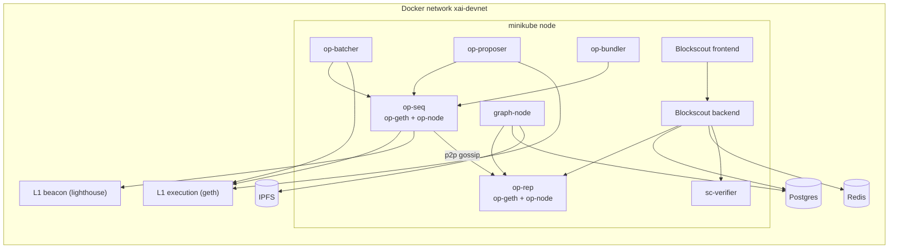

# Architecture

This page describes what runs, where it runs, and how the pieces find each other.

## Components

| Component                                               | Role                                                  | Runs in           | Version                                  |
|---------------------------------------------------------|-------------------------------------------------------|-------------------|------------------------------------------|
| Dev L1 (geth + lighthouse)                              | Ethereum L1 for the rollup                            | Docker (Kurtosis) | `ethereum-package` 6.1.0                 |
| `op-seq`: op-geth + op-node                             | L2 sequencer                                          | Kubernetes        | op-geth `v1.101702.2`, op-node `v1.19.4` |
| `op-rep`: op-geth + op-node                             | L2 read replica, used by the explorer and the indexer | Kubernetes        | same as above                            |
| `op-batcher`                                            | Posts L2 data to L1                                   | Kubernetes        | `v1.16.2`                                |
| `op-proposer`                                           | Posts output proposals to L1                          | Kubernetes        | `v1.16.3`                                |
| `xai-conf` (op-deployer)                                | One-off jobs: L1 contracts, genesis, rollup config    | Kubernetes        | op-deployer `v0.7.1`                     |
| Blockscout (backend, frontend, smart-contract verifier) | Block explorer                                        | Kubernetes        | `9.0.2`, `v2.3.5`, `v1.11.0`             |
| graph-node                                              | The Graph indexer                                     | Kubernetes        | `v0.45.0`                                |
| Skandha (`op-bundler`)                                  | ERC-4337 bundler                                      | Kubernetes        | `v2-2.4.6`                               |
| Postgres                                                | Database for Blockscout and The Graph                 | Docker Compose    | `postgres:18-alpine`                     |
| IPFS (kubo)                                             | Storage for The Graph                                 | Docker Compose    | `ipfs/kubo:v0.43.1`                      |
| Redis                                                   | Cache for Blockscout                                  | Docker Compose    | `redis:8-alpine`                         |

OP Stack components are released independently, so their version numbers differ. This is the combination tested together.

## Diagram

## How the replica follows the sequencer

The replica (`op-rep`) is a read node. Its op-node has the sequencer disabled, and it is connected to the sequencer by P2P gossip:

- The replica op-node connects to the sequencer op-node on TCP port `9222`, with a static peer address. The address contains the peer ID of the sequencer. The ID is stored in `sequencerId` in the
  ConfigMap `p2p-config-env`, and it is derived from the key `priv` in the Secret `p2p-private-key`. If you change the key, change the ID too (see [Configuration](configuration.md#sequencer-peer-id)).
- Through this connection the replica receives the new blocks from the sequencer as soon as they are produced. These blocks are still "unsafe": the replica also reads the data that the batcher posts
  to the L1, and this is how its blocks become safe and finalized.
- The explorer and the indexer read from the replica, so they do not load the sequencer.
- Send transactions to the sequencer (`op-seq`, port `8545`). The replica has no forwarding endpoint to the sequencer configured, so do not use it to send transactions.

## Network plan

Every component that runs outside the cluster, and the minikube node itself, belongs to one Docker network. Pods reach the L1, Postgres, IPFS and Redis through this network.

| Item             | Value                                                                |
|------------------|----------------------------------------------------------------------|
| Network name     | `xai-devnet`                                                         |
| Subnet           | `172.25.0.0/24`, gateway `172.25.0.1`                                |
| Dynamic range    | `172.25.0.0/25` (Docker assigns addresses here)                      |
| Static addresses | from `172.25.0.128` upwards, so they never collide with dynamic ones |
| MTU              | 1400                                                                 |

| Component           | Address                                   | Attached to the network by                                       |
|---------------------|-------------------------------------------|------------------------------------------------------------------|
| L1 execution client | `172.25.0.129`                            | `xai-tools l1 start` (Kurtosis container, connected after start) |
| L1 beacon client    | `172.25.0.130`                            | `xai-tools l1 start`                                             |
| Redis               | `172.25.0.198` (alias `redis.xai.local`)  | Docker Compose (`data/`)                                         |
| Postgres            | `172.25.0.199` (alias `psqldb.xai.local`) | Docker Compose (`data/`)                                         |
| IPFS                | `172.25.0.200` (alias `ipfs.xai.local`)   | Docker Compose (`data/`)                                         |
| minikube node       | `172.25.0.247`                            | `minikube start --network --static-ip`                           |

Static addresses let you reach the databases from the host without mapping their ports to localhost. On Linux the host reaches these addresses directly.

These values are constants of the project. They are written in more than one file: see [Configuration](configuration.md#fixed-values).

## Startup flow

`make up` runs these steps in order:

1. **env**: copy every `.env.example` to `.env` (existing files are kept).
2. **network**: create the Docker network.
3. **cluster-up**: start minikube on the Docker network, with CRI-O and the ingress, ingress-dns and registry addons. The resources come from `CPUS` and `MEMORY`.
4. **images**: build the `xai-conf` image and push it to the minikube registry.
5. **bc-up**: create the blockchains. It runs `bc-init` and then `bc-start`:
    1. `bc-init`:
        1. start the L1 with Kurtosis and attach it to the network;
        2. `l2 init`: apply the setup resources, run the `init-l2` job, then the `init-seq` and `init-rep` jobs.
    2. `bc-start`:
        1. start Postgres, IPFS and Redis from scratch, and wait until their ports answer (this is the default of the `BC_PRE_SETUP` hook, see [Hooks](#hooks));
        2. `l2 start`: start the sequencer, then the replica, batcher, proposer and graph-node, then the explorer;
        3. deploy the deterministic proxy and the EntryPoint (see [Contracts](contracts.md));
        4. start the bundler.

`make down` runs `bc-down` and then `cluster-down`:

- `bc-down` deletes the L2 resources from Kubernetes, including the volumes, and removes the L1. Then it stops Postgres, IPFS and Redis **without deleting their data** (the default of the
  `BC_POST_DOWN` hook), so you can inspect the data after the shutdown.
- `cluster-down` stops minikube. It does not delete the cluster.

A start always begins from scratch: `bc-start` deletes the data of Postgres, IPFS and Redis before it starts them again, even if the previous shutdown was not clean.

`make bc-restore` runs `bc-down` and `bc-up`: it rebuilds the blockchains and leaves the cluster running.

### Hooks

The Makefile has extension points for people who inherit it. A hook is a variable that holds a command line, run before or after a step. All hooks are empty, except `BC_PRE_SETUP` and `BC_POST_DOWN`.

| Hook                                    | Runs                                        | Default                                             |
|-----------------------------------------|---------------------------------------------|-----------------------------------------------------|
| `CLUSTER_PRE_UP`, `CLUSTER_POST_UP`     | before and after minikube starts            | empty                                               |
| `CLUSTER_PRE_DOWN`, `CLUSTER_POST_DOWN` | before and after minikube stops             | empty                                               |
| `BC_PRE_INIT`, `BC_POST_INIT`           | before and after `bc-init`                  | empty                                               |
| `BC_PRE_SETUP`                          | in `bc-start`, before the L2 services start | recreates Postgres, IPFS and Redis from scratch     |
| `BC_POST_SETUP`                         | in `bc-start`, after the bundler starts     | empty                                               |
| `BC_PRE_DOWN`                           | before the blockchain stops                 | empty                                               |
| `BC_POST_DOWN`                          | after the blockchain stops                  | stops Postgres, IPFS and Redis and keeps their data |
| `CUSTOM_DEPS`                           | after the deps install                      | empty                                               |
| `CUSTOM_IMAGES`                         | after the images build                      | empty                                               |

Set a hook on the command line, in the environment, or in a Makefile that includes this one. Do not set it in a `.env` file: those files only accept plain `KEY=value` lines. Setting a hook that has a
default replaces it. If you override `BC_PRE_SETUP` and still want a clean start of the data services, include that command in your value. If you override `BC_POST_DOWN`, include the stop of the data
services if you still want it.

The Makefile finds its own folder (`WORKDIR`), so it can be included from a Makefile in another folder.

### What the init jobs do

- `init-l2` runs op-deployer. It deploys the OP Stack contracts on the L1, then writes `genesis.json`, `rollup.json` and `addresses.json` to a shared work volume, plus an `.env` file with the dispute
  game factory address.
- `init-seq` and `init-rep` initialize the op-geth data directories of the sequencer and of the replica with the generated genesis.

### Storage

| Volume        | Size  | Content                                            |
|---------------|-------|----------------------------------------------------|
| `l2-workdir`  | 50Mi  | Generated L2 configuration, shared by several pods |
| `l2-seq-data` | 500Mi | Sequencer data                                     |
| `l2-rep-data` | 500Mi | Replica data                                       |

The work volume is `ReadWriteOnce` and is used by several pods. This works on a single-node cluster such as minikube, and is one reason why only a single node is supported.

## Limits

- One sequencer, no high availability.
- No monitoring, no backups, no key rotation.
- The `dev` setup exposes admin APIs inside the cluster and allows any CORS origin.